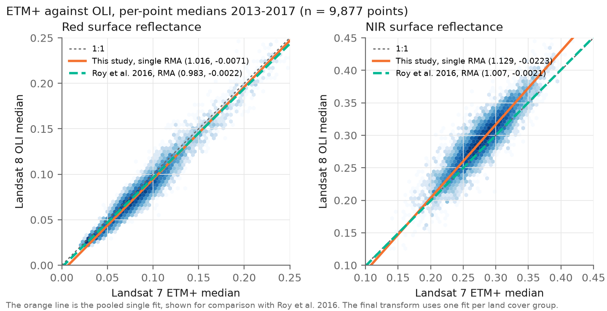
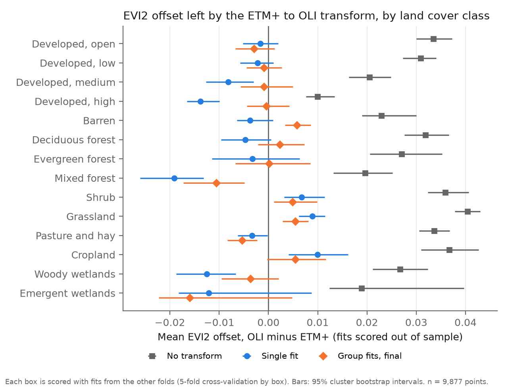
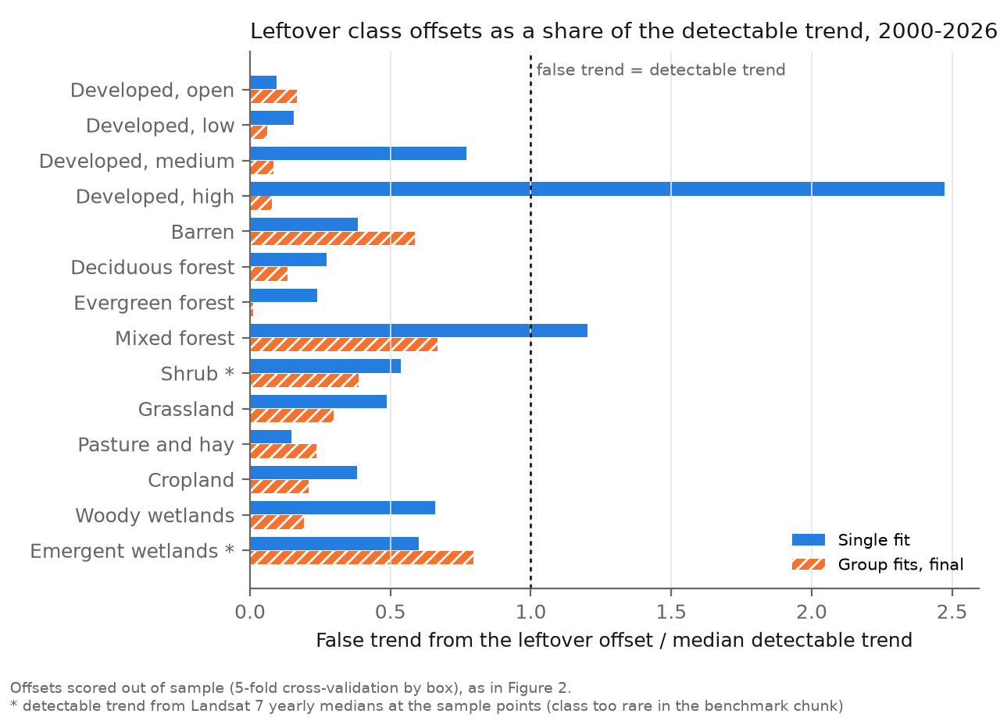
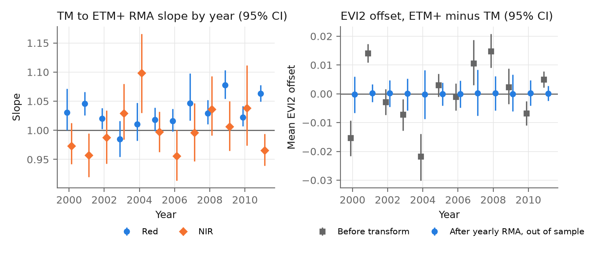
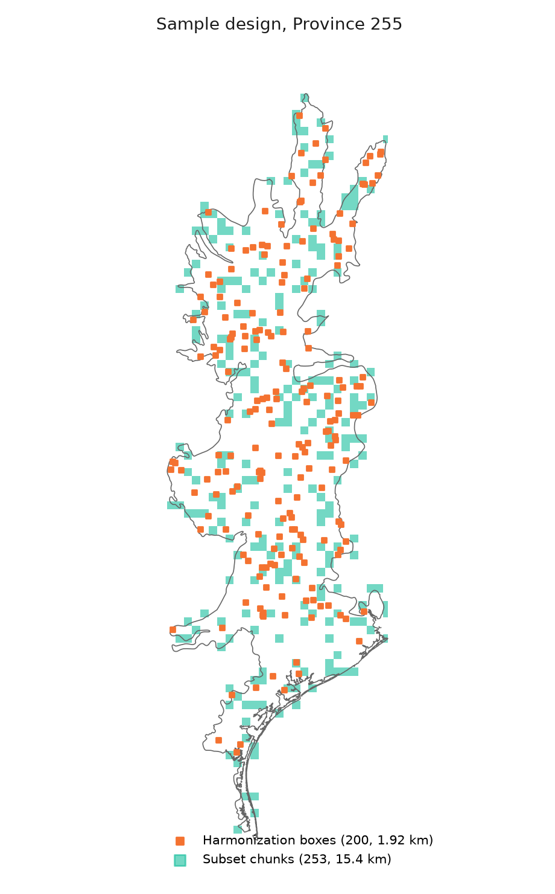
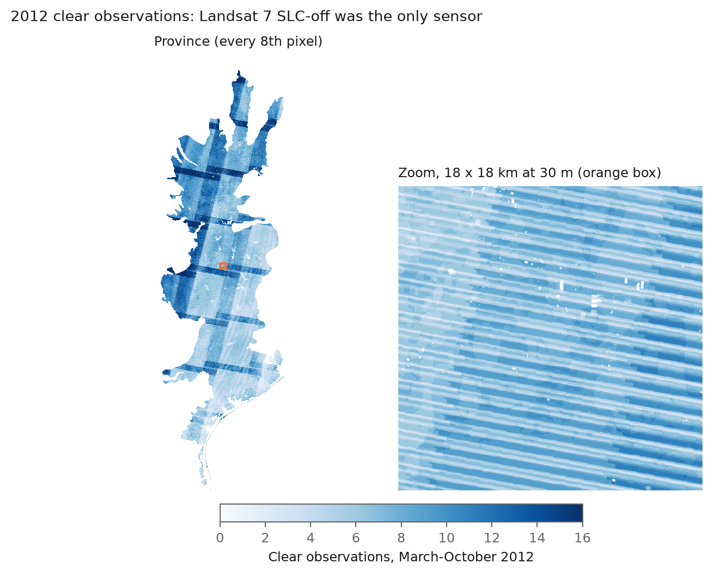

# Greening and Browning in Texas and Oklahoma Prairie Parkland, 2000-2026

Where did vegetation greenness change across Bailey's Prairie Parkland (Subtropical) Province 255 over the last 27 years, how did trends differ by land cover, and how much of the change remains once drought is accounted for?

**Status: results in progress.** Phase 3 of 5 (data production). The cross-sensor harmonization is final and the annual composites are being exported. Trend results, maps, and the write-up come in Phases 4 and 5. All dates in this repository, in version tags, and in reports are UTC.

## Harmonization diagnostics

Four Landsat sensors (TM, ETM+, OLI, OLI-2) span the record, so the first result is how well they were put on one scale. Red and NIR surface reflectance from TM and ETM+ are transformed to OLI before any index is computed. The coefficients were fitted on our own Collection 2 data in the study area. The sample is 10,005 pixels in 200 boxes of 64 x 64 pixels, all with the same Annual NLCD class from 2000 to 2017. Of these, 9,877 had at least 10 clear observations from each sensor in 2013-2017 and entered the ETM+ to OLI fit. Each TM to ETM+ year used the points with at least 6 clear observations from each sensor that year. Version `harm-v1-2026-11-27`.

* **ETM+ to OLI**: one reduced major axis (RMA) line per band for each of three land cover groups (woody, herbaceous, and developed with barren), fitted on per-pixel medians over all 2013-2017 dates both sensors cover. The pooled fit explains 96% of red and 84% of NIR variance between the sensors' medians, and the transform removes the mean EVI2 offset of 0.033.
* **TM to ETM+**: one RMA line per band for every year 2000-2011, which absorbs the Landsat 5 orbital drift.
* Roy et al. (2016) RMA coefficients, fitted on earlier (pre-Collection) Landsat processing, leave a mean EVI2 offset of 0.025 of the 0.033 in our Collection 2 data, which is why the study fits its own.

Figure 1 shows the pooled single fit, for comparison with Roy et al. (2016). The final transform uses one fit per land cover group.

The single ETM+ to OLI fit left offsets of up to 0.019 EVI2 in some land cover classes. A leftover offset acts as a step at 2013, so it could create a false trend. Figure 2 shows the offsets by class with no transform, with the single fit, and with the group fits. To avoid scoring a fit on the points it was fitted to, the fits were checked out of sample: the 200 boxes were split into 5 folds, and each fold was scored with lines fitted on the other four.

Group fits do not remove every class offset. Mixed forest (-0.011 EVI2) keeps a measurable offset, and emergent wetlands (-0.016) has the largest one, although it comes from only 15 boxes and its interval reaches zero. Both classes are reported separately. Barren (+0.006 against -0.004) and pasture and hay (-0.005 against -0.003) are slightly worse under the group fits than under the single fit. Every class still stays below its minimum detectable trend: the largest false trend is 0.79 of the detectable trend, in emergent wetlands (Figure 4, out-of-sample offsets).

TM to ETM+ offsets change from year to year and are significant in 8 of 12 years, so they are corrected year by year. Scored out of sample, the yearly transforms leave mean offsets within 0.0003 of zero in every year.

Sample design: 200 boxes of 64 x 64 pixels for the harmonization fits, and 253 chunks of 512 x 512 pixels (18.9% of the province) for the single-sensor subset checks.

In 2012 only Landsat 7 was imaging. In Figure 6, the broad dark bands are where neighbouring Landsat paths overlap, so those pixels are seen from two orbits. The fine stripes are the gaps left by the failed Landsat 7 scan line corrector (SLC-off). The analysis flags pixels whose greenness tracks their observation count.

The figures are made by `src/05_figures_harmonization.py`. Methods, limitations, and every design decision are in [docs/phase1_plan.md](docs/phase1_plan.md).

## Approach in one paragraph

Landsat 5, 7, 8, and 9 Collection 2 surface reflectance, harmonized across sensors, is composited into a March-October median EVI2, NIRv, and kNDVI for every 30 m pixel and year. Per-pixel trends use the Theil-Sen slope with a Mann-Kendall test corrected for autocorrelation, and false discoveries are controlled across 274 million pixels. A pixel is an index-consistent trend when it is significant in EVI2 and agrees in sign with NIRv and kNDVI. Single-sensor subsets, an observation-density check, and a leave-one-year-out check test whether trends survive sensor and sampling effects. Trends are summarized on stable Annual NLCD land cover pixels and compared with drought (SPEI) through residual trend analysis.

## Compute budget

Composites are made in Google Earth Engine under a noncommercial quota measured in EECU-hours, so every export was costed before it ran.

| Work | EECU-hours |
|---|---|
| Pilot export, 2012, measured | 21.4 |
| Harmonization sample, 13 batch tasks, measured | 58.7 |
| Main composites, 15 years (batches B1, B2, B4), measured | 470.6 (projected 484) |
| Main composites, other 12 years, projected | 375 |
| Single-sensor subsets 2015-2017, whole-province region, measured | 91.2 |
| Single-sensor subsets, other 17 years, one export per chunk, projected | about 56 |
| Roy et al. comparison on the chunk sample, one export per chunk, projected | about 25 |
| **Composites and checks, projected total** | **about 1,020** |

This table will be updated with measured values as batches finish.

The single-sensor subsets were first exported one year at a time, masked to the 253 sampled chunks. Masking did not reduce the cost, because the export region was still the whole province and Earth Engine computed every pixel in it. The first three years cost 91 EECU-hours instead of the expected 24. The subsets moved to one export per chunk. A test measured 0.013 EECU-hours for one chunk and 0.042 for a block of four, so cost follows the area exported.

Design choices that cut cost:

* Harmonization sample points grouped in small boxes and run as batch tasks, about 10 times cheaper per year than scattered points.
* Scenes filtered by the province outline instead of its bounding box, and scenes over 90% cloud skipped: about 21% fewer scenes.
* Single-sensor subsets and the Roy et al. comparison run on an 18.9% chunk sample, one chunk per export.
* Plain GeoTIFF without overviews: 26% less storage.

## Repository layout

| Path | Contents |
|---|---|
| `config/config.yaml` | Study area, years, season, thresholds, grid, harmonization version, compute settings |
| `src/rstrends/` | Pure functions with no network access: QA decoding, indices, harmonization fits, trend tests, power, flags, sampling |
| `src/NN_*.py` | Numbered pipeline scripts that do data access |
| `tests/` | pytest tests on small synthetic arrays |
| `docs/` | Plan, setup guide, figures |

Data is never stored in the repo. It lives in a separate data folder set by `RS_DATA_DIR`.

## Reproduce

1. Install Miniconda, then create the environment from conda-forge:
   `CONDA_CHANNEL_PRIORITY=strict conda env create -f environment.yml`
2. Set up Earth Engine: [docs/earth_engine_setup.md](docs/earth_engine_setup.md)
3. Check setup: `conda run -n rs-trends python src/00_check_setup.py`
4. Run tests: `conda run -n rs-trends pytest`

## How this was built

The code was developed with an AI coding agent (Claude Code) under my direction. I set the research questions and the design, made every decision recorded in the plan, and reviewed each phase before the next one started. `CLAUDE.md` holds the working rules the agent followed.

## Data and citations

* Landsat Collection 2 Level-2 surface reflectance, courtesy of the U.S. Geological Survey. Landsat 4-5 TM: https://doi.org/10.5066/P9IAXOVV. Landsat 7 ETM+: https://doi.org/10.5066/P9C7I13B. Landsat 8-9 OLI/TIRS: https://doi.org/10.5066/P9OGBGM6.
* U.S. Geological Survey. Annual National Land Cover Database (NLCD) Collection 1 Products (ver. 1.2, June 2026). https://doi.org/10.5066/P94UXNTS. Accessed in Earth Engine through the awesome-gee-community-catalog (https://gee-community-catalog.org).
* Cleland, D.T., et al. 2007. Ecological Subregions: Sections and Subsections for the conterminous United States. Gen. Tech. Report WO-76D. USDA Forest Service. https://doi.org/10.2737/WO-GTR-76D
* Roy, D.P., et al. 2016. Characterization of Landsat-7 to Landsat-8 reflective wavelength and normalized difference vegetation index continuity. Remote Sensing of Environment 185, 57-70. https://doi.org/10.1016/j.rse.2015.12.024
* Gorelick, N., et al. 2017. Google Earth Engine: Planetary-scale geospatial analysis for everyone. Remote Sensing of Environment 202, 18-27. https://doi.org/10.1016/j.rse.2017.06.031

The full reference list is in [docs/phase1_plan.md](docs/phase1_plan.md).

## License

Code: MIT License ([LICENSE](LICENSE)). Derived data products and figures: Creative Commons Attribution 4.0 International ([LICENSE-DATA.md](LICENSE-DATA.md)). Source data keep their own terms: Landsat and Annual NLCD are U.S. Government works in the public domain.

Inspired by a 2016 class project with Zahra Ghaffari and Saber Brasher.
